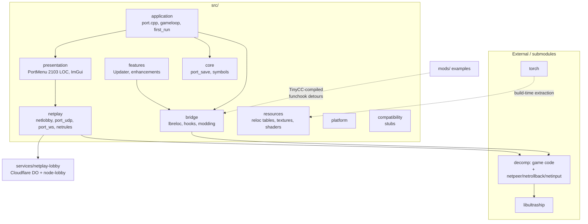

# Professionalization audit — smash-classic

**Date:** 2026-10-14 · **Scope:** full repository (post-2026-10 reorganization) ·
**Method:** read-only inspection of source, build, CI, docs + comparative
research against HarbourMasters (Shipwright, 2ship2harkinian), sm64coopdx,
Dolphin, Slippi, GGPO, mupen64plus, ares, OpenMW.

Findings use IDs `F-NNN`. Status: **V**erified / **P**robable /
**N**ot-verified / **R**ecommendation (preventive).

---

## Status update — findings fixed same-day (2026-10-14)

Fixed: F-002 (all test/mutation/fuzz/forge/boot-override hooks behind
`SSB64_TEST_HOOKS`, OFF in packaging; **verified**: `TEST_HOOKS=OFF` build
contains zero gated env names — enforced by `check_release_binary.py` inside
every packaging script), F-004 (`repo-checks.yml` now runs check_docs +
lobby suites + hygiene scans + env-var catalog check), F-005 (all
FetchContent deps SHA-pinned), F-010 (env-var catalog
`docs/development/env_vars.md` + `check_env_vars.py` CI gate covering all
103 `SSB64_*` reads), F-011 partial (save `.meta` sidecar + size check;
atomic write still open), F-012 (hygiene deletions), F-021 (governance
files + CODEOWNERS + PR template), F-022 partial (CycloneDX SBOM in release
via `tools/lint/gen_sbom.py`), F-025 (`.editorconfig`).

Still open: F-001 updater attestation verify, F-003 netplay extraction,
F-006 lobby conformance suite, F-009 component targets, F-016 unit-test
suite, F-018..F-020 corpus/golden work, TD-016 wrangler transitive vulns.

## A. Executive summary

### State

The project is already well above the median for a decomp port: it has a
responsibility-split `src/` tree, a real rollback implementation with a
behavioral test suite (synctest, localtest, mutants, packet fuzz, soak), an
input-injection-hardened lobby, pinned GitHub Actions, artifact attestations
in the release workflow, independent compatibility version constants, and a
normative protocol spec that matches the wire code. The dominant risks are
**not** missing paperwork — they are (a) the self-update path's trust model,
(b) test/fuzz/mutant hooks compiled into shipping binaries, (c) netplay
protocol code living inside the `decomp` submodule, (d) a 1496-line monolithic
CMakeLists with no component targets, and (e) almost no unit-test coverage
under `tests/` (4 files) — verification is nearly all script-driven.

### Maturity by area

| Area | Level (0–5) | Note |
|------|------|------|
| Repo organization | 4 | Reorganized; minor residue (`ci/`, `prs.json`, `build/`, empty `src/` placeholders — since removed) |
| Build | 3 | Presets + extract assets OK; CMake monolith, mixed dep pinning |
| Testing | 3 | Excellent behavioral harness; thin unit/golden coverage |
| Netplay/rollback | 4 | Real rollback + hostile-input tests; protocol lives in submodule |
| Lobby service | 3 | Hardened; two parallel impls to keep in sync |
| Security | 3 | Supply chain mostly good; updater trust + prod test hooks are the gaps |
| Releases | 3 | Attest + macOS codesign exist; no SBOM, no Windows signing |
| Governance | 2 | Issue templates + SECURITY/CONTRIBUTING yes; no CODEOWNERS/PR template/GOVERNANCE |
| Observability | 2 | `port_log` text logs; no structured events/bundle |
| Docs | 4 | Extensive, now lint-clean (`check_docs` 0 findings) |

### Top 10 highest-impact changes

1. **F-001** Close the update-path trust gap (attestation/sig verification, not just same-origin sha256).
2. **F-002** Strip or compile-gate test/mutant/fuzz env hooks from release builds.
3. **F-003** Move `netpeer.c`/rollback protocol code out of `decomp/` (or isolate it) — it's port code wearing a submodule costume; every protocol change is a cross-repo dance.
4. **F-004** Wire `check_docs.py` + lobby security/fuzz tests + `test-lobby-*` into CI; today nothing runs them.
5. **F-005** Split `CMakeLists.txt` into component targets (`smash_netplay`, `smash_bridge`, …) — enables per-target warnings and incremental checks.
6. **F-006** Add `smash-classic-sim` headless runner as a first-class CMake target (pieces exist: AUTOVS, MAX_FRAMES, traces — just not packaged as one).
7. **F-007** Version the save format (`port_save.cpp` writes no version field today).
8. **F-008** Merge or generate the two lobby implementations (cloudflare + node) from one source, or add a conformance test that pins their shared behavior.
9. **F-009** Catalog the ~157 `SSB64_*` env vars; split into user-facing config vs test hooks.
10. **F-010** Add CODEOWNERS + PR template + PR-gating workflow that runs lint/docs/tests.

### Top 10 quick wins

1. Delete `prs.json`, migrate or delete `ci/` (3 files), remove the empty `src/` placeholder dirs (config, diagnostics).
2. Add `.github/PULL_REQUEST_TEMPLATE.md` (30 lines: "testing performed", docs-touched checklist).
3. Add `.editorconfig` (siblings all have one; free).
4. Add CODEOWNERS (netplay → you, docs → you, etc.).
5. Pin the two remaining tag-pinned FetchContent deps to SHAs (v1.1.3, v3.4.0) with tag comments.
6. One-line workflow job: `python tools/lint/check_docs.py`.
7. Add `AGENTS.md` or symlink-free pointer to CLAUDE.md (house standard across AniNexus/dnd-companion).
8. Add CHANGELOG.md (referenced by PR rules, currently absent).
9. `.git-blame-ignore-revs` for the big move commit once it lands (OpenMW pattern).
10. CONTRIBUTING.md: add the "TODO(#issue)" convention + phased-work rules already in CLAUDE.md so humans see them too.

---

## B. Current architecture (verified)

### Real tree summary

```
smash-classic/
├── CMakeLists.txt          # 1496 lines — single target list, still monolithic
├── CMakePresets.json       # new; configure presets
├── VERSION, config.yml     # app version; Torch extraction entry point
├── baserom.us.z64          # user ROM (gitignored) at root
├── build/                  # legacy build dir (ignored; out/ is the convention now)
├── ci/windows/             # 3 files: UWP Dockerfile + build-uwp.ps1 — legacy
├── cmake/                  # Codegen.cmake, RuntimeAssets.cmake, funchook patch
├── config/                 # semgrep + static-analysis config
├── decomp/                 # submodule — game code AND netpeer.c/netrollback.c
├── include/smash_classic/  # version.h (independent compat constants)
├── libultraship/, torch/   # engine + asset-tool submodules
├── services/netplay-lobby/ # cloudflare/ (485-line worker) + node-lobby.js (428) + tests
├── src/                    # ~38k LOC port layer
│   ├── application/  bridge/  core/  netplay/  features/
│   ├── presentation/ resources/ platform/ compatibility/
│   ├── config/  diagnostics/   # EMPTY placeholder dirs (created, unused)
├── assets/                 # extraction recipes, controller db, css-icons source
├── mods/                   # examples + templates
├── tests/                  # 4 files only: coroutine, extern_ids, vpk0 ×2
├── tools/ scripts/ docs/ out/ lint-reports/ platforms/
```

### Component / dependency map



### Critical flows

- **Boot**: `main` → port init → LUS window/graphics → locate `BattleShip.o2r`
  (+ recipe-hash sidecar check) → boot decomp scene manager → ImGui shell.
- **Assets**: user ROM → Torch (`-s` staged `torch-src/` with `config.yml` +
  `assets/configuration/extraction/<region>` recipes) → `BattleShip.o2r`
  beside binary. `f3d.o2r` shaders built separately.
- **Local match**: decomp scene → `gamemanager` → sim ticks, port hooks for
  save/mods/reloc.
- **Netplay**: lobby ws (SSBL text protocol) → slot assign → UDP `SYNETPEER`
  mesh/star links (+ relay via ws when configured) → input staging →
  rollback resim on confirmed-tick mismatch → desync via confirmed-state
  hash exchange.
- **Rollback**: `netrollback.c` snapshots BSS/DATA/arena each tick; resim
  suppresses side effects via `syNetRollbackIsResimulating()` gates (audio,
  rumble — audited 2026-10-14).
- **Mods**: TinyCC-compiled native DLLs in memory + funchook detours;
  registry snapshotted into `compat_token()` for lobby handshake.
- **Update**: Updater queries GitHub releases API → downloads zip → checks
  size + sha256 from the *same release metadata* → runs install script.

### Doc-vs-code divergence

`docs/architecture/overview.md` was updated for the move and mostly tracks.
Remaining drift: it still describes `port/` module names in a few spots
(mostly fixed by the user edits); the empty `src/` placeholder dirs
(config, diagnostics) implied nonexistent components — since removed.

---

## C. Target architecture (incremental, pragmatic)

No new layers. Three targeted extractions only:

```
src/netplay/
├── protocol/     # wire layout, serialize/parse/validate — pure functions, no I/O
├── transport/    # port_udp, port_ws — socket code only
├── rollback/     # snapshot/resim glue calling into decomp
└── lobby/        # netlobby, netrules
```

```
services/netplay-lobby/
├── cloudflare/   # deployable
├── node/         # local-dev, MUST pass the same conformance suite
└── shared/       # (recommended) the protocol constants + validators shared by both
```

**Dependency rules (checkable)**: `protocol/` includes nothing from
`transport/`,`lobby/`,`presentation/`; `transport/` sees only `protocol/`;
enforced later by component targets + include-dir scoping in CMake, and
cheaply today by a grep-based CI rule (candidate for `check_docs`-style lint).

**Test hooks boundary** (new rule): every `SSB64_*` env var is either
*user config* (documented, stable) or *test hook* (`SSB64_TEST_*` prefix,
compiled out in Release). See F-002/F-010.

---

## D. Comparison with similar projects

| Project | Observed practice | Source | Applicable? | Cost/notes |
|---------|-------------------|--------|-------------|------------|
| **Shipwright** | Two-stage CI: build `soh.o2r` once on Ubuntu, platform jobs `needs:` it | `.github/workflows/generate-builds.yml` | **Yes, directly** — our ExtractAssets is ROM-gated so we can't ship the o2r, but the *pattern* (asset job → fan-out) applies to building `f3d.o2r` + tools once | Low; slight CI rework |
| **Shipwright** | LUS as root submodule; game dir (`soh/`) separate from engine | `.gitmodules` | Already done (same structure) | — |
| **Shipwright** | `mods/` drop-in folder shipped in artifacts with `custom_otr_files_go_here.txt` | release zips | Yes — mirrors our `mods/` intent | Trivial |
| **2ship2harkinian** | `clang-format.yml` CI workflow; port code namespaced `mm/2s2h/` | repo | clang-format enforcement — we have `.clang-tidy` but **no `.clang-format`** | Low; decide style first (decomp excluded) |
| **Anchor (2s2h multiplayer)** | Multiplayer as separate service/process, JSON protocol spec repo (`Sail`) | github.com/garrettjoecox/anchor | Pattern, not the model — they're state-sync co-op, we need input rollback | — (validates our lobby-as-service split) |
| **sm64coopdx** | Lua modding: per-mod isolated `_ENV`, dangerous functions removed, ~4000 bindings **autogenerated** | `autogen/`, docs/lua/ | The *autogen bindings + sandboxed env* pattern maps to our TinyCC mods: today native code = full trust; a capability/sandbox story is the gap | Large; P5 |
| **sm64coopdx** | In-repo API docs + categorized release notes | docs/lua/ | Yes for `docs/modding/` | Low |
| **Dolphin** | `Core::WantsDeterminism()` + `SyncIdentifier` game-identity check before netplay | `NetPlayClient.cpp` | Our `compat_token()` is the equivalent — manifest (TD-008) is the planned upgrade | Medium |
| **Dolphin** | FifoCI: recorded GPU command streams replayed in CI for regression | github.com/dolphin-emu/fifoci | Expensive to replicate; our confirmed-trace diffs already give an equivalent for *simulation*, not rendering | High, optional |
| **Dolphin** | Pinned clang-format + `Tools/lint.sh` + CMakePresets workflow presets | Contributing.md | Presets partially; pin format version | Low |
| **Slippi** | Rollback split game-side/emulator-side; **isolate fork deltas in one dir** (`Source/Core/Core/Slippi/`) to stay mergeable with upstream | Ishiiruka | **Directly applicable** — our netplay lives inside `decomp/` which is the "upstream" equivalent. F-003 is exactly the Slippi lesson | Medium; high payoff |
| **Slippi** | Matchmaking state machine + published file spec (`SPEC.md`, `COMM_SPEC.md`) | slippi-wiki | Done — we now have `docs/netplay/protocol/specification.md` | — |
| **GGPO** | Hard requirements doc: deterministic sim, serializable state, step-one-frame-without-render | doc/DeveloperGuide.md | We satisfy all three (snapshot = memcpy regions; AUTOVS = headless step). Codify as a checklist in protocol docs | Trivial; done partially |
| **mupen64plus / ares** | Plugin-per-repo vs monorepo-with-`ruby`-style platform abstraction | repos | We're closer to ares (monorepo, single build); keep that | — |
| **OpenMW** | Two-phase review (functionality then code), "what testing you carried out" mandatory in MR | CONTRIBUTING.md | **Yes** — put in PR template | Trivial |
| **OpenMW** | `.git-blame-ignore-revs`, `apps/`+`components/` split, per-MR coverage | repo | blame-ignore after the move commit; coverage optional | Trivial |

### Standards (verified)

- **OpenSSF Scorecard**: `ossf/scorecard-action` SHA-pinned; job constraints (no env/defaults; only checkout/upload-sarif/upload-artifact/scorecard/harden-runner steps); needs `security-events: write` + `id-token: write`; trigger on default-branch push + weekly + `branch_protection_rule`.
- **SLSA provenance**: `slsa-github-generator` is unmaintained (v2.1.0, Feb 2025); recommended path is **`actions/attest` / `actions/attest-build-provenance`** — which we *already use* in `release.yml`. Gap is verification on the consumer side (updater), not generation.
- **SBOM for C++/CMake**: no dominant tool; `Keysight/cmake-sbom` (SPDX 2.3 from install artifacts) or CycloneDX via package manager. Realistic for us: generate SBOM listing FetchContent pins + submodules + system deps; attach to release + attest it.
- **Cloudflare DOs**: use WebSocket **Hibernation API** (`ctx.acceptWebSocket`, `serializeAttachment`, auto ping/pong); DOs hibernate ~10s idle and lose memory state — our worker is a standard-API ws server held alive by connections; hibernation migration is optional but would cut cost.
- **GitHub repo security checklist**: dependabot alerts, secret scanning, push protection, code scanning (CodeQL present ✓), dependency review on PRs, private vulnerability reporting + SECURITY.md (✓ present).

---

## E. Findings register

Severity: **C**ritical **H**igh **M**edium **L**ow **I**nfo. Effort: S/M/L.

### Security

| ID | Sev | Area | Evidence | Finding | Fix | Status |
|----|-----|------|----------|---------|-----|--------|
| F-001 | H | updater | `src/distribution/updater/Updater.cpp:463,551` | sha256 digest + zip both come from the same GitHub release; a forged/compromised release supplies both → integrity-against-corruption only, not tamper-resistance. Windows zip unsigned (macOS codesign exists, release.yml:91-146). | Verify GitHub artifact attestation (`gh attestation verify` semantics embedded via Sigstore bundle) or sign a release manifest with an offline key; document residual risk in `docs/security/update-security.md` | V |
| F-002 | H | test hooks | `netpeer.c` (MUTANT/PACKETFUZZ), `netlobby.cpp` (`SSB64_COMPAT_TOKEN` env override) | Mutant hooks that accept bad sessions/checksums + a compat-token override are reachable via env vars in any build that ships them | `#ifdef` them out in Release (`NDEBUG`-gated or explicit `SSB64_TEST_HOOKS` compile flag) | V |
| F-003 | H | boundary | `decomp/src/sys/netpeer.c` 2516 LOC | Protocol/security-critical port code lives in the decomp submodule: every protocol bump = fork branch + pointer bump; contributes nothing to decomp fidelity | Move to `src/netplay/` (or src/netplay/protocol/); the decomp include path can export the small header | V |
| F-004 | M | CI | `tools/lint/check_docs.py`, `services/netplay-lobby/tests/test-lobby-*.js` | Doc checker + lobby security/fuzz tests exist but **no workflow runs them** — regression risk invisible | Add a `lint-docs` job + a `lobby-tests` job (node, no ROM needed) | V |
| F-005 | M | deps | `CMakeLists.txt:233,891` | Two FetchContent deps pinned by **tag** (`v1.1.3`, `v3.4.0`) — mutable; third already SHA-pinned | Pin to commit SHA, keep tag comment | V |
| F-006 | M | lobby | worker `index.js` + `node-lobby.js` | Two hand-maintained implementations of the same lobby protocol; one was already patched twice in parallel (spec routing). Drift = security bugs | Shared conformance test suite run against both (they share wire format), or generate shared validator module | V |
| F-007 | M | netplay | `docs/security/network-threat-model.md` | Lobby compromise not defended (no E2E, session id server-issued); documented residual | Optional: session MAC keyed by lobby-issued upkey; defer, documented | V(documented) |
| F-008 | L | secrets | workflows, wrangler.toml | No secrets in repo (checked); `id-token: write` scoped to release only ✓ | Enable GitHub secret scanning + push protection (repo setting, not a file) | V |

### Architecture / maintainability

| ID | Sev | Area | Evidence | Finding | Fix | Status |
|----|-----|------|----------|---------|-----|--------|
| F-009 | H | build | `CMakeLists.txt` 1496 LOC | One file still carries all targets/globs/options; only Codegen+RuntimeAssets extracted | Component targets: `ssb64_decomp` (existing), `smash_bridge`, `smash_netplay`, `smash_app` — per-target warning levels | V |
| F-010 | M | config | 157 distinct `SSB64_*` env vars | Huge undocumented configuration surface; mixing user config and test hooks | Catalog in docs/development/env_vars.md (planned); rename test-only to `SSB64_TEST_*`; fold stable ones into typed config | V |
| F-011 | M | saves | `src/persistence/port_save.cpp` | No format version field — `SAVE_FORMAT_VERSION` constant exists but the file format doesn't write it | Add header {magic, version, size, crc}; migration path per `docs/compatibility/saves.md` | V |
| F-012 | M | hygiene | `ci/` (3 files), `prs.json`, `build/`, empty `src/` placeholders | Root residue post-migration | Delete/migrate `ci/windows`→`platforms/uwp` or `scripts/development`; remove `prs.json` + empty dirs — done | V |
| F-013 | M | size | `netlobby.cpp` 1798, `netpeer.c` 2516, `PortMenu.cpp` 2103, `lbreloc_byteswap.cpp` 2300 | Largest files all sit on the netplay/UI hot paths; CLAUDE.md step-0 rule applies | Split during the netplay protocol extraction (F-003) rather than standalone churn | V |
| F-014 | L | include discipline | include dirs = every leaf | Bare `"foo.h"` includes resolve anywhere → dependency direction unenforced | Component targets fix this naturally (F-009) | V |
| F-015 | I | docs | 571 md files | `docs/` is a strength but ~40 `docs/bugs/` entries are append-only narrative; index works | Keep; don't restructure history | V |

### Testing

| ID | Sev | Area | Evidence | Finding | Fix | Status |
|----|-----|------|----------|---------|-----|--------|
| F-016 | H | unit | `tests/` = 4 files | Essentially zero unit coverage of port code (parser edge cases, reloc, config); all verification is process-level PS1 harnesses | Add gtest (already-FetchContent pattern exists) with `smash_tests` target; start with `protocol/` codec — pure functions, easy win | V |
| F-017 | M | determinism | `determinism.yml` | Suite exists but is **entirely ROM-gated** (skips without `BASEROM_US_Z64` secret) — right call legally; consequence: external forks get no signal | Also run ROM-free tests unconditionally (unit codec, lobby tests, doc check) | V |
| F-018 | M | fuzz | `netpeer.c` fuzz tiers | Seeded in-engine fuzz exists ✓, but no coverage-guided libFuzzer target + no crash-input corpus/minimization | Add tests/fuzz/ (planned) libFuzzer harness on the pure `protocol/` codec after F-003 | V |
| F-019 | M | assets | none | No golden asset test (hash/size/count per region) — recipe hash covers drift but not content regressions | tests/fixtures/assets/ (planned) golden manifests (TD-006) | V |
| F-020 | L | replays | `tests/fixtures/replays/` empty | Corpus dirs created but empty | Seed with a recorded desync regression replay | V |

### Governance / DX / releases

| ID | Sev | Area | Evidence | Finding | Fix | Status |
|----|-----|------|----------|---------|-----|--------|
| F-021 | M | governance | `.github/` | No CODEOWNERS, no PR template, no GOVERNANCE/MAINTAINERS/SUPPORT; siblings (AniNexus, dnd-companion) all have the full set | Add the 4 files + PR template w/ "testing performed" (OpenMW rule) | V |
| F-022 | M | CI | `release.yml` | Attestation + macOS signing ✓; **no SBOM**, no hash manifest published for release assets | Publish `*.sha256` + CycloneDX/SPDX SBOM + attest it | V |
| F-023 | L | CI | workflow perms | `contents: read` defaults good; release needs write (justified + commented) | Optional `step-security/harden-runner` on release job | V |
| F-024 | L | docs | none | `docs/README.md` index exists; add audit + register links | Link this audit from index | V |
| F-025 | L | format | `.clang-tidy` yes, `.clang-format`/`​.editorconfig` no | No formatting contract | Add `.editorconfig` now; `.clang-format` only for `src/` (never decomp) — 2ship pattern | V |
| F-026 | I | legal | extraction pipeline | ROM-derived data never in repo; recipe-hash gating documented; add automated "prohibited file" CI check (block *.z64/*.n64/ROM-ish blobs) | tools/lint/check_no_rom_assets.py (planned) | R |
| F-027 | I | submodules | worktree script | Physical move deferred per ADR-0002 — correct call; revisit only when `new-worktree.sh` can re-point clones | Keep as is | V |

**Cross-cutting probable items (P):** thread-safety of `sLobby` vs worker threads (netlobby + udp thread share state — not audited deeply); unbounded growth of some port_log outputs (rotation policy undocumented).

---

## F. Professionalization plan (phases)

### P0 — Security & critical risk
**Goal:** nobody can ship a malicious update or bypass validation via env vars.
- F-001 updater attestation verification (or offline-signed manifest)
- F-002 compile-gate all test/mutant/fuzz/override hooks (`#ifndef NDEBUG` or dedicated flag — verify with a Release build grep for the env strings in the binary)
- F-005 SHA-pin the 2 tag-pinned FetchContent deps
- F-012 hygiene deletions
*Done when:* release binary contains no mutant/fuzz env strings; updater rejects a tampered zip even with a forged digest; CI deps all SHA-pinned.

### P1 — Architectural bases
**Goal:** netplay becomes a normal component; build becomes modular.
- F-003 extract `netpeer.c`/`netrollback.c`/`netinput.c` → src/netplay/{protocol,rollback} (5-file phases per CLAUDE.md; keep ABI)
- F-009 component CMake targets + per-target warnings
- F-011 save format header + version field
- F-010 env-var catalog
*Done when:* protocol change = a diff in `src/` only; `smash_netplay` builds standalone; `port_save` writes/reads versioned headers.

### P2 — Quality & automation
- F-004 CI jobs: docs-check, lobby-tests, unit tests (F-016 first target: protocol codec)
- F-021 CODEOWNERS + PR template + governance files
- F-025 .editorconfig (+ decide clang-format scope for `src/`)
- `.git-blame-ignore-revs` after the migration commit
*Done when:* a PR gets red ❌ for a broken doc link or failed lobby security test.

### P3 — Advanced testing & determinism
- F-016 gtest suite grows (codec, save migration, reloc utils)
- F-006 `smash-classic-sim` packaged as a target (AUTOVS+MAX_FRAMES+trace = existing pieces)
- F-018 libFuzzer targets on pure codec
- F-019 golden asset manifests; F-020 replay corpus seeding
*Done when:* `ctest` runs something; nightly determinism matrix + ROM-free CI signal exist side by side.

### P4 — Releases & supply chain
- F-022 SBOM (cmake-sbom or CycloneDX) + `*.sha256` manifest + attestation covering both
- F-023 harden-runner on release
- OpenSSF Scorecard workflow (SHA-pinned action, constrained job)
- Dependency-review action on PRs
*Done when:* release zip + sha256 + SBOM + attestation verify end-to-end; Scorecard badge live.

### P5 — Mods, extensibility, scale
- Capability manifest for mods (cosmetic/simulation/netplay-unsafe classes — netrules already names them)
- sm64coopdx-style autogen for mod API surface if/when the SDK grows
- F-006 lobby conformance suite shared by both impls
*Done when:* a mod manifest declares its class and netplay enforces it.

### P6 — Physical cleanup
- `ci/` remnants, `prs.json`, empty dirs, `build/` → `out/` habits
- Re-evaluate submodule physical moves (still deferred — ADR-0002)

---

## G. Backlog (executable issues)

Compact issue specs (labels: see issue-template convention `area:*`, `type:*`, `priority:*`):

1. **Verify attestation in updater** — `area:build type:security priority:critical` — add sigstore bundle verify or offline-manifest sig check in `Updater.cpp`; AC: tampered zip + forged digest rejected; negative test in CI.
2. **Compile-gate test hooks** — `area:netplay type:security priority:high` — wrap `SSB64_NETPLAY_MUTANT`/`PACKETFUZZ`/`COMPAT_TOKEN` in `SSB64_TEST_HOOKS` macro; AC: `strings` on Release binary shows none.
3. **Extract netplay from decomp** — `area:netplay type:refactor priority:high` — phased move of `netpeer.c`/`netrollback.c`/`netinput.c` + headers; AC: protocol bump changes only `src/` files; submodule diff for netplay goes to zero.
4. **Component CMake targets** — `area:build type:refactor priority:high` — `smash_bridge`, `smash_netplay`, `smash_app`; AC: `cmake --build --target smash_netplay` works; warnings scoped.
5. **CI: docs + lobby tests** — `area:build type:feature priority:normal` — two ROM-free jobs; AC: PR fails on broken link / lobby security regression.
6. **Save format v1 header** — `area:platform type:feature priority:normal` — {magic,version,size,crc}; AC: old saves migrate; corrupted header rejected gracefully.
7. **Env-var catalog + rename** — `area:documentation type:documentation priority:normal` — docs/development/env_vars.md (planned); AC: every var categorized user/test.
8. **gtest harness + codec tests** — `area:netplay type:feature priority:normal` — FetchContent gtest; AC: ≥20 codec cases incl. all error paths.
9. **SBOM + sha256 manifest in release** — `area:build type:feature priority:normal` — AC: `gh attestation verify` on SBOM passes.
10. **CODEOWNERS + PR template + governance** — `type:documentation priority:normal` — AC: PRs get auto-review-request; template rendered.
11. **Lobby conformance suite** — `area:lobby type:feature priority:high` — script runs identical scenario against cloudflare + node impls; AC: same transcript.
12. **scorecards workflow** — `area:build type:feature priority:low` — AC: badge + SARIF upload.
13. **Hygiene deletions** — `type:refactor priority:low` — `ci/`, `prs.json`, empty dirs.
14. **`smash-classic-sim` target** — `area:netplay type:feature priority:normal` — wraps AUTOVS/MAX_FRAMES/trace; AC: `ctest` runs a 60s headless match.
15. **Prohibited-asset CI check** — `type:security priority:normal` — AC: fails CI if a ROM-like blob is staged.
16. **.editorconfig + blame-ignore-revs** — `type:documentation priority:low`.
17. **libFuzzer targets** — `area:netplay type:feature priority:normal` — after #3; AC: tests/fuzz/* runs in CI job (min 60s/fuzzer nightly).
18. **Mod capability manifest** — `area:mods type:feature priority:normal` — AC: netplay handshake rejects undeclared simulation mods.
19. **Save/config migration tests** — fixtures under `tests/fixtures/saves`.
20. **Structured logging event layer** — `area:observability type:feature priority:low` — wrap `port_log` sink; AC: `--log-json` emits JSONL.

---

## H. PR plan

| PR | Contents | Rule honored |
|----|----------|--------------|
| 1 | Hygiene deletions + `.editorconfig` + governance files + PR template | docs/meta only, no code |
| 2 | FetchContent SHA pins + scorecards workflow + dependency-review | CI only |
| 3 | Compile-gate test hooks (F-002) | functional isolation — touches netplay source but no wire change |
| 4 | Updater attestation verify (F-001) | security fix, own PR, needs test |
| 5 | Save format header + migration (F-011) | format change with docs |
| 6 | `netpeer*` → src/netplay/protocol extraction (F-003) | pure move, no behavior — biggest single PR, do when no netplay debugging is in flight |
| 7 | CMake component targets (F-009) | build-only |
| 8 | docs/lobby CI jobs + unit-test skeleton | CI only |
| 9 | SBOM + sha256 + attestation extension | release-only |
| 10 | env-var catalog + renames | docs + mechanical rename, separate from behavior |

*Never mix:* moves+behavior, format+fix, protocol+UI, submodule-pointer+architecture.

---

## I. Quality gates

| Surface | PR gate | Nightly | Release |
|---------|---------|---------|---------|
| Format/lint | clang-tidy (existing), codespell, yamllint, **check_docs** (F-004) | full lint matrix | all |
| Build | windows + linux minimal | +android/uwp | all + package smoke |
| Unit | `smash_tests` (codec first) | all | all |
| Netplay | codec tests + lobby conformance | synctest 1/3/6, localtest matrix, packet fuzz, mutants, soak | full + cross-build |
| Determinism | — | Release-vs-Debug trace diff | same |
| Security | dependency-review, codeql, secrets | scorecards refresh | SBOM+attest verify |
| Docs | check_docs + protocol-change rule (netplay code → spec update or justification) | — | changelog required |
| Assets | recipe-hash check | golden manifests | golden + region matrix |

---

## J. End state

- **Structure**: as now, minus `ci/`/`prs.json`/empty dirs; `src/netplay/` internally split; protocol code out of `decomp`.
- **Build**: presets-first; component targets; all deps SHA-pinned; `out/` only.
- **Testing**: gtest codec/save unit suite + existing behavioral suite + fuzz corpus + golden assets; `ctest` real.
- **Security**: updater verifies attestation; test hooks stripped in release; Scorecard + secret scanning + push protection on.
- **Releases**: zip/apk/appimage + `.sha256` + `.spdx.json`/`.cdx.json` + attestations; changelog per release.
- **Governance**: CODEOWNERS, PR template ("testing performed" mandatory), labels, issue templates (done), blame-ignore-revs.
- **Observability**: structured log events + diagnostic bundle exporter.
- **Compatibility**: version constants already landed; save/config formats actually write their versions; session manifest (TD-008) enforces sim inputs before matches.
- **Docs**: linted in CI; spec kept normative against code; ADR per boundary change.

## Appendix — sibling-project house style observed

AniNexus / dnd-companion / odysseus all carry: `AGENTS.md`, `CITATION.cff`,
`CODE_OF_CONDUCT.md`, `CONTRIBUTING.md`, `SECURITY.md`, `SUPPORT.md`,
`Makefile`/`compose.*`, `docs/`, tests dirs, lint configs. smash-classic
should match that baseline (it now has CONTRIBUTING+SECURITY; missing
CODE_OF_CONDUCT, SUPPORT, AGENTS.md pointer).
