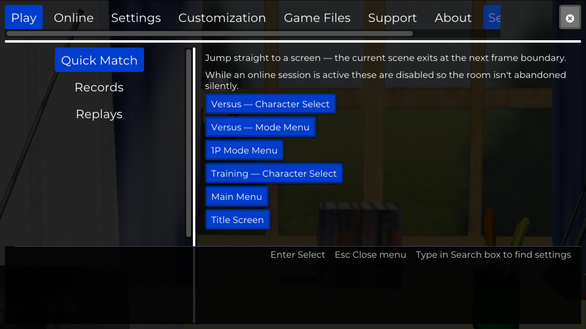
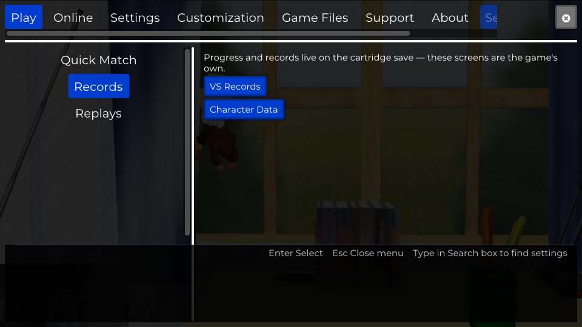
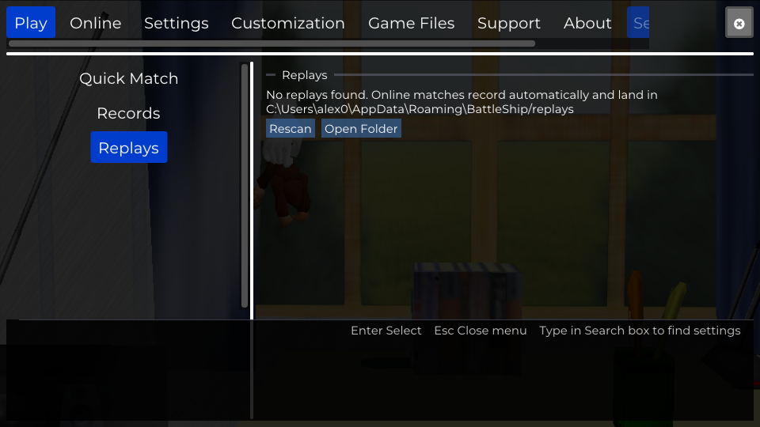
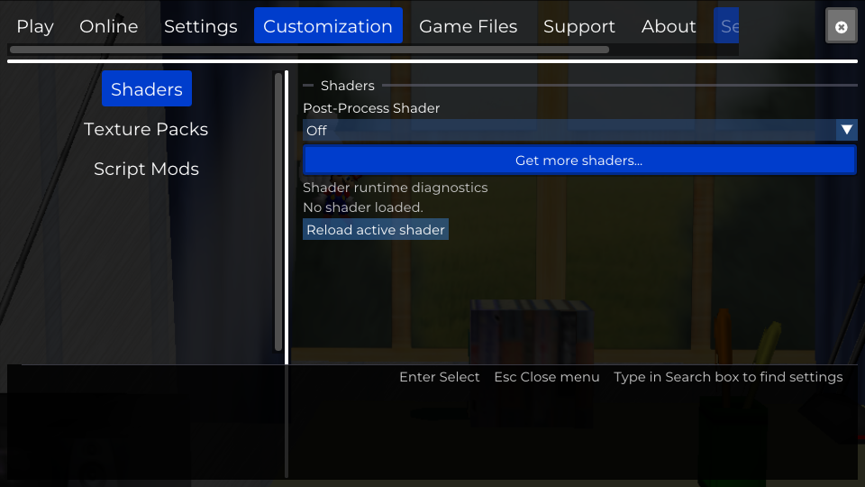
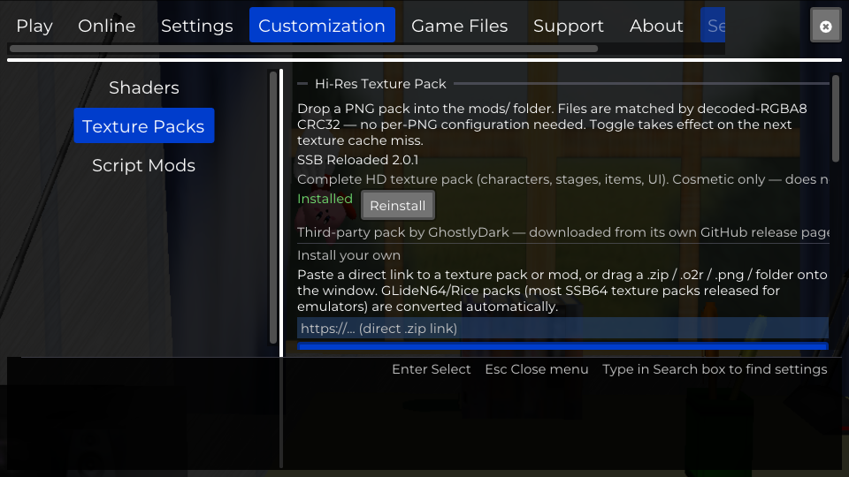
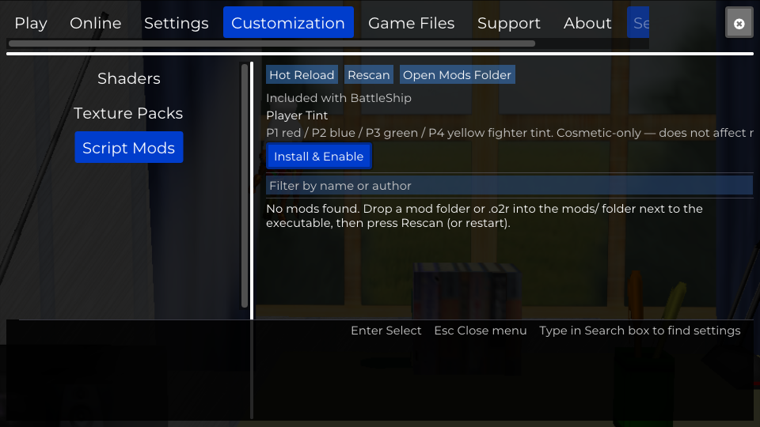
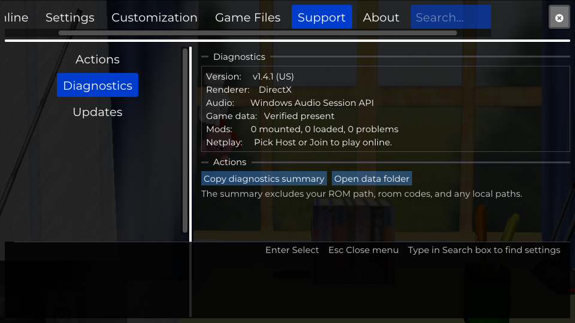
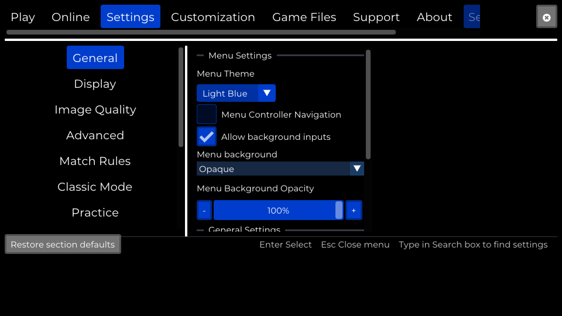
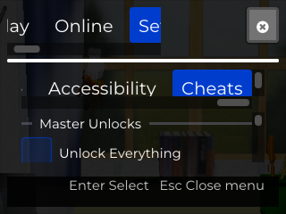
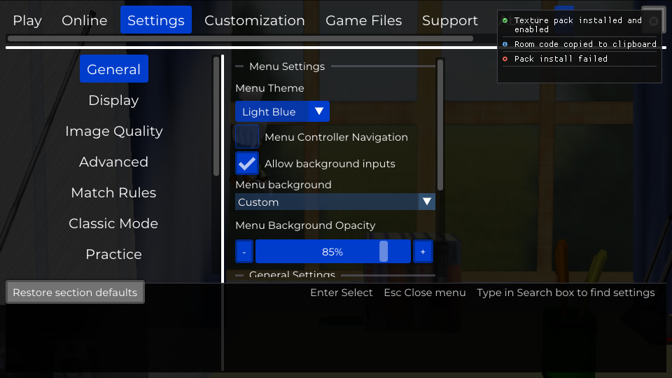

# Menu screenshots

Per-section captures of the in-game menu (ESC). Regenerate with:

```bash
python tools/developer/testing/shoot_menu_sections.py
```

Requires a dev build with `SSB64_TEST_HOOKS` (the script uses
`SSB64_SCREENSHOT_FRAMES` / `SSB64_MAX_FRAMES`). All shots run at 960×540
except `menu-compact.png` (320×240, exercises the compact layout: collapsed
header scroll + horizontal section strip).

## Visual regression

`../baseline/` holds the accepted reference PNGs; `../matrix/` holds the
responsive matrix (4 key sections × {1280×720, 1920×1080, 320×240, 559×360,
561×360} × UI scales {0.75, 1.0, 1.5, 2.0}).

```bash
# Approve current output as the new baseline
python tools/developer/testing/shoot_menu_sections.py --baseline docs/screenshots/baseline

# Capture to a scratch dir and pixel-diff against the baseline
# (fails when >2% of pixels differ by more than 32/255 per channel)
python tools/developer/testing/shoot_menu_sections.py \
    --out out/menu_shots --diff docs/screenshots/baseline

# Resolution / UI-scale matrix
python tools/developer/testing/shoot_menu_sections.py --matrix --out docs/screenshots/matrix

# One-off size or scale for the whole gallery
python tools/developer/testing/shoot_menu_sections.py --size 1280x720 --ui-scale 1.5 --out out/shots
```

Note: the live game scene bleeds through the translucent menu backdrop, so
pixel diffs carry background noise — `--diff-tolerance`/`--max-diff-ratio`
tune that, and `--baseline` should only run after a clean build, never as a
blind approval of a broken one.

## Play

| | |
|---|---|
|  |  |
| Quick Match | Records |
|  | |
| Replays | |

## Settings

| | |
|---|---|
|  |  |
| General | Display |
|  |  |
| Image Quality | Advanced |
|  |  |
| Match Rules | Classic Mode |
|  |  |
| Practice | Interface |
|  |  |
| Input Mappings | Control Enhancements |
|  |  |
| Audio | Accessibility |
|  | |
| Cheats | |

## Online


## Customization

| | |
|---|---|
|  |  |
| Shaders | Texture Packs |
|  | |
| Script Mods | |

## Game Files

| | |
|---|---|
|  |  |
| Extraction | Paths |

## Support

| | |
|---|---|
|  |  |
| Actions | Diagnostics |
|  | |
| Updates | |

## About


## Windows & states

| | |
|---|---|
|  |  |
| Stats overlay | Console |
|  |  |
| Gfx Debugger | Controller Config |
|  |  |
| Menu in popout window | Menu with controller nav hints |
|  |  |
| Menu background: Opaque preset | Compact layout at 320×240 |
|  | |
| Non-blocking toasts (info/success/warning/error) | |

## Not capturable automatically

- First-run wizard — requires a real ROM and a clean profile; capture manually.
- Update prompt — only appears when the updater finds a newer release.
- Lobby "in room" / "in match" states — need an active netplay session.
- Online Status window — only has meaningful content during a live netplay
  session; removed from auto-capture.
